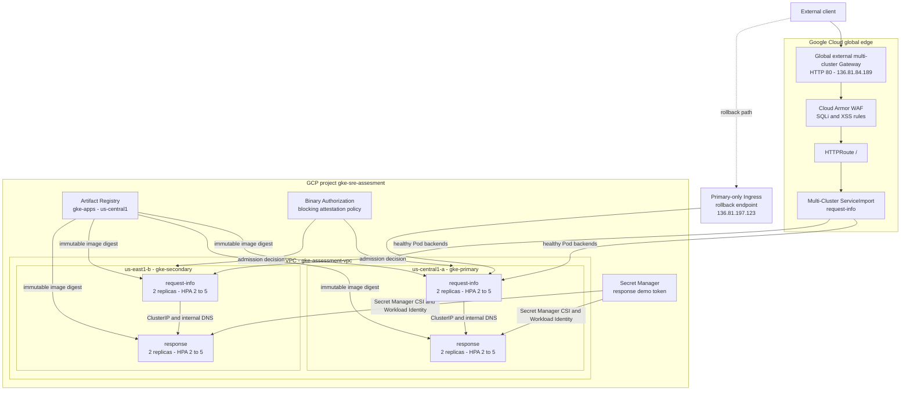
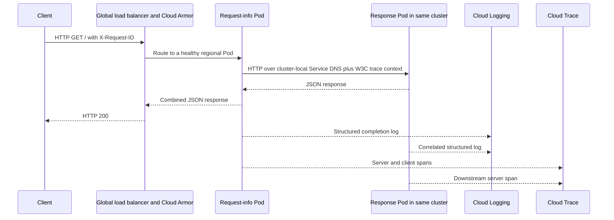
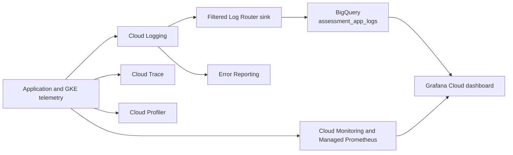
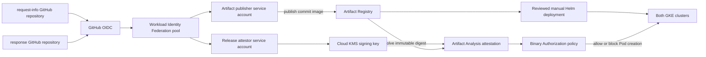

# As-Built Architecture and Design Rationale

**Verified:** October 11, 2026  
**Project:** `gke-sre-assesment`  
**Scope:** Deployed assessment environment

## System context

The assessment runs two independent stateless Go applications in two zonal GKE
Standard clusters. A global external multi-cluster Gateway distributes public
HTTP traffic to healthy request-info Pods in either region. Request-info calls
the response service over cluster-local Kubernetes DNS, so both hops remain in
the same cluster during normal traffic and regional failover.

The dotted Ingress path is retained only as a temporary rollback endpoint. The
global Gateway is the multi-region assessment entry point. Application B is
not publicly exposed.

## Request and telemetry flow

Cloud Logging retains Kubernetes and structured application logs. A filtered
Log Router sink exports primary request-completion records to BigQuery dataset
`assessment_app_logs`. Grafana Cloud reads those BigQuery records for error and
latency panels and reads Cloud Monitoring for pod restart, CPU, and memory
panels. Both applications export traces and profiles through GKE Workload
Identity; Error Reporting groups application exceptions from structured logs.

## Software supply chain and delivery boundaries

Application teams own separate source, test, container, Helm, and release
lifecycles. Platform/SRE owns Google Cloud infrastructure, fleet routing,
security controls, observability configuration, runbooks, and evidence.

The publisher cannot sign releases, and the signer cannot publish images.
GitHub trusts are restricted to the two application repositories on `main`.
Application CI tests, builds, publishes, resolves the digest, and creates a
KMS-backed attestation. CD remains a separate reviewed Helm action pinned to
`repository@sha256:digest`. Binary Authorization blocks a digest that does not
satisfy `gke-release-attestor`.

The platform repository runs Terraform formatting in CI. Infrastructure apply
is deliberately manual: review the PR and saved plan, merge, regenerate the
plan from `main`, and then apply. Four Terraform roots have isolated GCS state
prefixes for foundation, primary cluster, secondary cluster, and multi-cluster
fleet configuration.

## Network and workload boundaries

| Boundary | Deployed design |
| --- | --- |
| VPC | One custom VPC with global routing. |
| Primary subnet | `10.10.0.0/20`; Pods `10.20.0.0/16`; Services `10.30.0.0/20`. |
| Secondary subnet | `10.40.0.0/20`; Pods `10.50.0.0/16`; Services `10.60.0.0/20`. |
| Clusters | Zonal GKE Standard clusters with three `e2-medium` nodes each. |
| Public entry | Global external multi-cluster Gateway on HTTP port 80. |
| Regional routing | Fleet membership, ServiceExport/ServiceImport, health-checked Pod backends, and automatic failover. |
| Application A | Request-info is exported through MCS; two baseline replicas, HPA, probes, PDB, and resource controls. |
| Application B | Response remains private behind a ClusterIP Service; two baseline replicas, HPA, probes, PDB, and resource controls. |
| Workload identity | Kubernetes service accounts use GKE workload principals; no workload service-account keys are stored. |
| Secrets | Response mounts a Secret Manager value through the GKE CSI integration without mirroring it into a Kubernetes Secret. |
| Images | Shared regional GAR repository; GKE node identities have repository-scoped read access. |
| Admission | Project singleton Binary Authorization policy requires the KMS-backed release attestor and blocks failures. |

## Design decisions and rationale

### Separate repositories and responsibilities

Three repositories model independent application teams and a platform/SRE
team. Each application can release independently, while shared infrastructure
and operational policy remain centrally reviewed. This is more representative
of an organization than storing unrelated applications and infrastructure in
one repository.

### Stateless applications and local dependencies

Both services are stateless, so regional failover does not require database
replication or conflict resolution. Request-info calls the response Service in
its own cluster. A regional request therefore does not introduce a cross-region
application dependency or egress path.

### Zonal clusters for the assessment

Two zonal clusters demonstrate geographic redundancy while limiting free-trial
cost. They do not provide control-plane or node high availability within one
region. Production should use regional clusters with node pools spread across
zones and should combine HPA with node autoscaling or reserved capacity.

### Shared primary-region Artifact Registry

A single repository reduces assessment complexity and supports both clusters.
It is a recovery dependency on `us-central1`; production should add repository
replication or a tested secondary-registry promotion strategy when regional
registry loss is in scope.

### Gateway API and MCS

The implementation uses the current Gateway API plus Multi-Cluster Services
rather than the older MultiClusterIngress API. The global Gateway sends traffic
directly to healthy exported Pod backends. Controlled backend withdrawal proved
that it fails over without a DNS change.

### Audit before enforcement

Binary Authorization was first deployed in audit mode. That phase found and
corrected an attestation public-key-ID mismatch without interrupting workloads.
After immutable digests passed in both clusters, a separately reviewed change
enabled blocking enforcement. A controlled mismatched attestation was then
denied before Pod creation.

### Manual deployment approval

CI publishes and attests artifacts but does not administer clusters. Manual,
reviewed Terraform and Helm actions keep deployment authority separate from
build authority and make each assessment change observable. A production
organization could automate CD behind protected environments and approvals
without combining publisher, signer, and deployer identities.

## Assessment-to-production deltas

| Assessment implementation | Production recommendation |
| --- | --- |
| Public HTTP IP with no owned domain | Stable global address, authoritative DNS, Certificate Manager authorization, HTTPS listener, and HTTP redirect/removal. |
| Zonal Standard clusters | Regional clusters with multi-zone node pools, autoscaling, maintenance policy, and capacity planning. |
| Nodes have external IP addresses | Private nodes, Private Google Access, Cloud NAT, egress firewall policy, and NAT logging. |
| Three fixed nodes per cluster | Cluster autoscaler or Node Auto Provisioning aligned with HPA maxima and disruption budgets. |
| Shared GAR in `us-central1` | Multi-region/replicated artifact strategy and tested promotion or rebuild procedure. |
| Temporary Grafana service-account credential | Keyless or brokered Grafana-to-GCP authentication with rotation and centralized secret management. |
| Stateless demo services | Database-native HA, PITR, cross-region replication, restore tests, and data-classification controls when state is introduced. |
| No service mesh | Add only when mTLS identity, traffic shaping, or mesh policy justifies the operational cost. |

These are documented deltas, not claims about controls deployed in the
assessment. HTTPS/DNS and Cloud NAT have detailed implementation criteria in
[HTTPS, External DNS, and Cloud NAT Disposition](https-dns-disposition.md).

## Evidence map

- [Multi-cluster Gateway, Cloud Armor, and failover](evidence/multi-cluster-gateway.md)
- [HPA scaling](evidence/hpa-scaling.md)
- [Distributed tracing](evidence/distributed-tracing.md)
- [BigQuery log export](evidence/bigquery-log-export.md)
- [Grafana dashboard](evidence/grafana-dashboard.md)
- [Binary Authorization enforcement](evidence/binary-authorization-enforcement.md)
- [Disaster recovery and backup runbook](runbooks/disaster-recovery.md)
